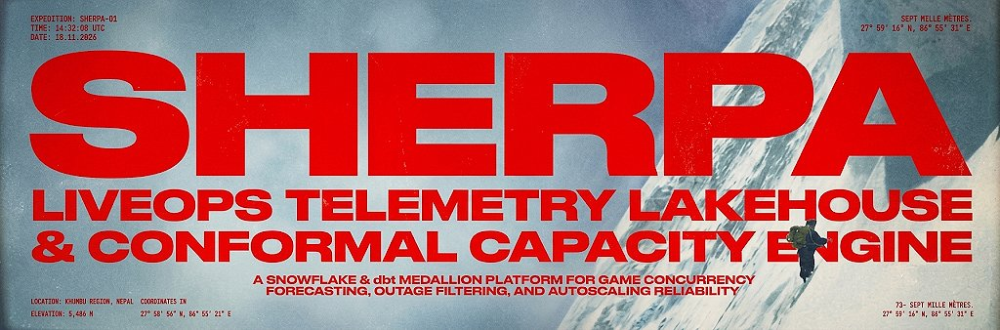
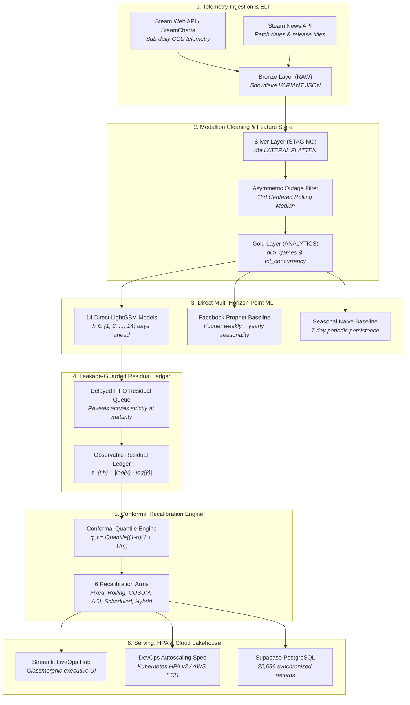
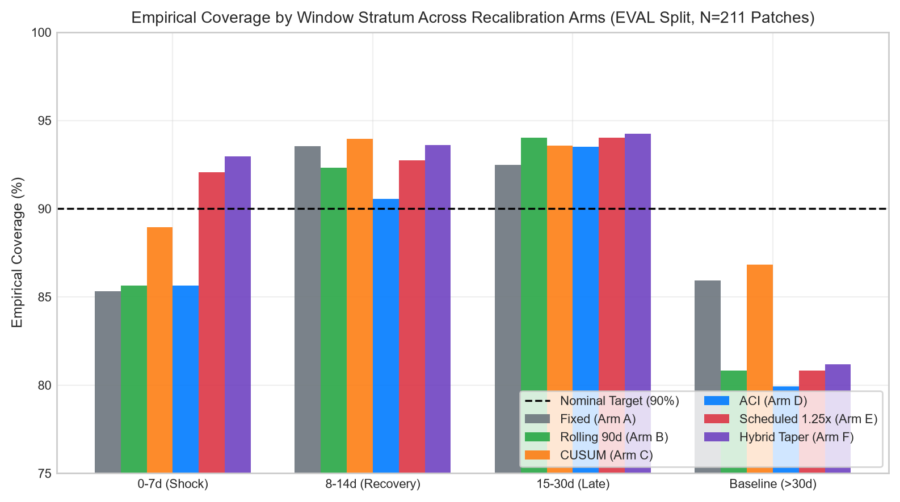
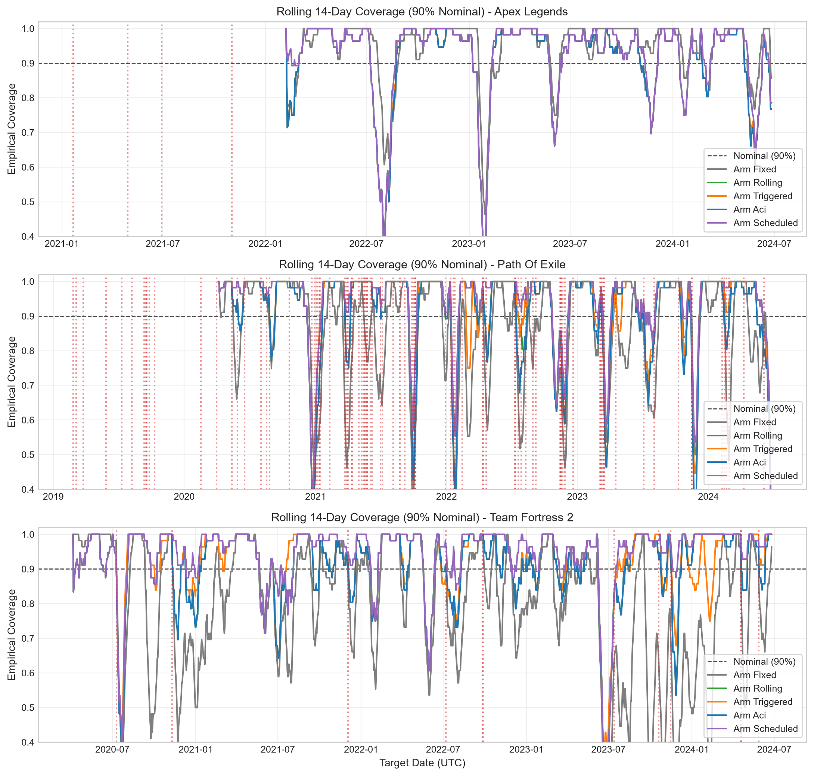
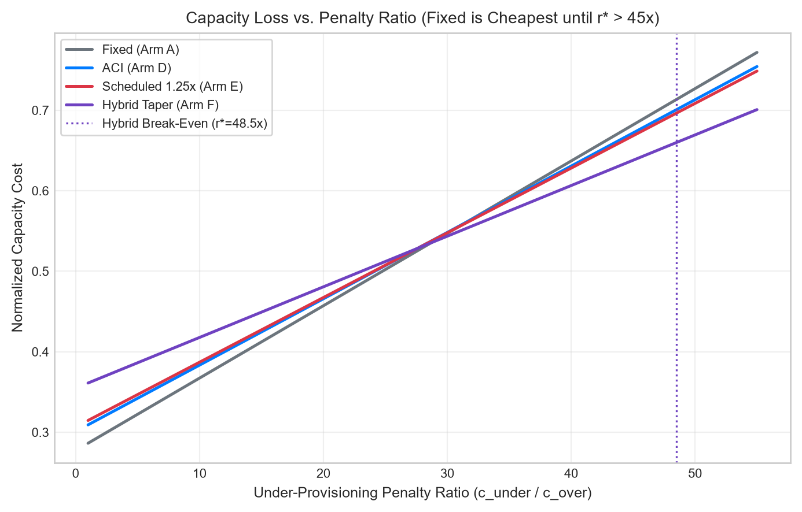
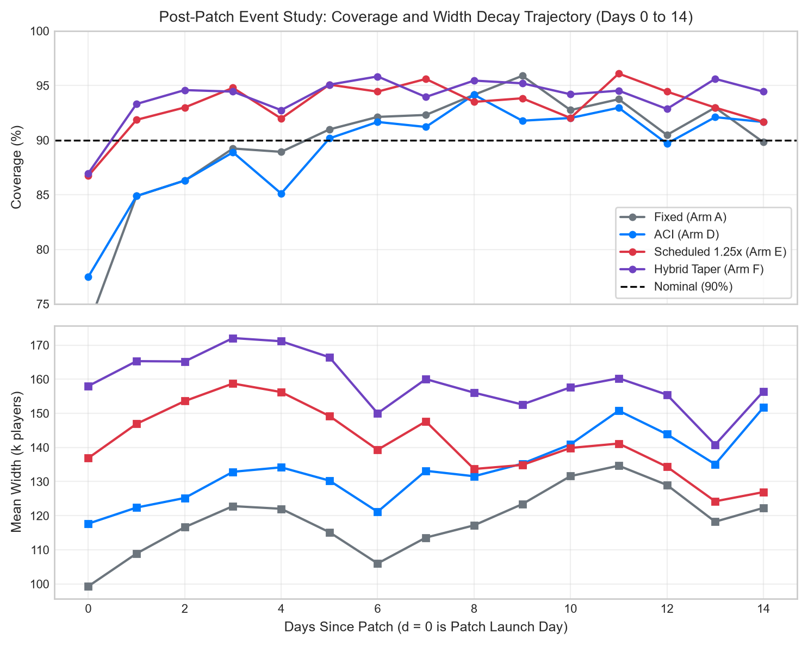
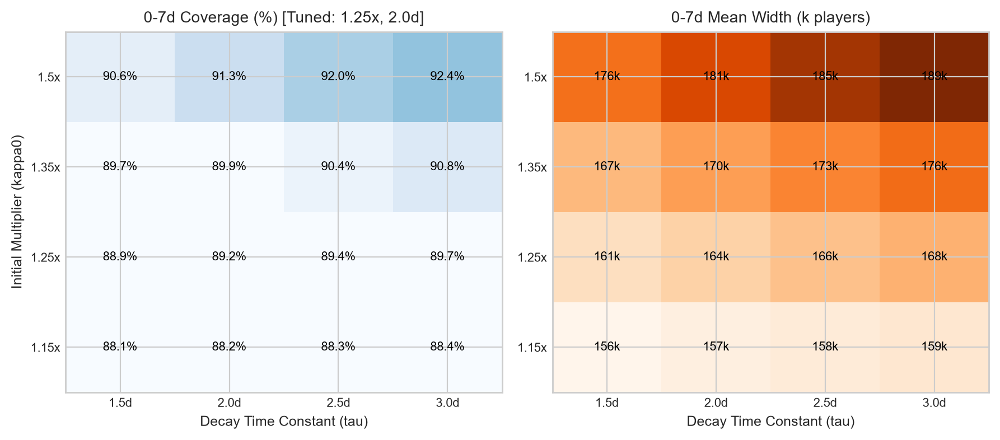
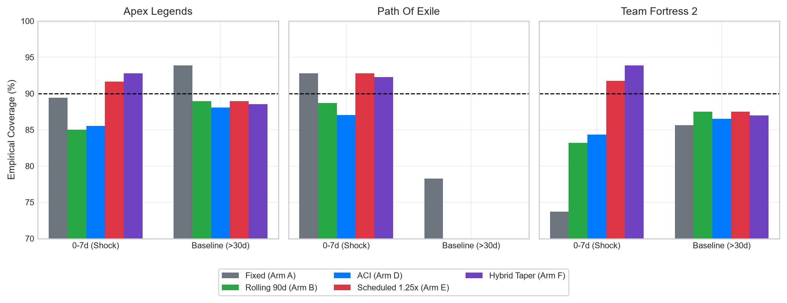

# Sherpa: LiveOps Telemetry Lakehouse & Conformal Capacity Engine
### A Snowflake & dbt Medallion Platform for Game Concurrency Forecasting, Outage Filtering, and Autoscaling Reliability

<div align="center">



[**Overview**](#executive-overview) • [**The Asymmetric Problem**](#the-liveops-problem-asymmetric-capacity-risk) • [**Architecture**](#system-architecture) • [**Medallion Lakehouse**](#medallion-lakehouse-architecture) • [**Conformal Policies**](#conformal-recalibration-policies) • [**Master Results**](#master-results-summary) • [**DevOps HPA**](#devops-horizontal-pod-autoscaler-hpa) • [**Quickstart**](#quickstart--reproduction-guide)

</div>

---

## Executive Overview

In live-service multiplayer gaming (*Apex Legends*, *Path of Exile*, *Team Fortress 2*), seasonal expansions and balance updates trigger abrupt **interventional distribution shifts** in player concurrency (CCU). While standard point forecasting breaks down around content updates, live operations (LiveOps) and cloud infrastructure teams depend on **prediction interval reliability**:

$$\hat{I}_{t+h} = [\text{lo}_{t+h}, \text{hi}_{t+h}] \quad \text{such that} \quad P(y_{t+h} \le \text{hi}_{t+h}) \ge 1 - \alpha$$

**Sherpa** is a production data engineering lakehouse and conformal uncertainty quantification platform evaluated across **211 verified game patch events** and **6,328 held-out multi-horizon daily forecasts** with paired cluster bootstrap confidence intervals ($B=2,000$).

```
Post-Patch SLA Target (Nominal): 90.0%
------------------------------------------------------------------------
Fixed Conformal Baseline:        85.3%  (Under-covers during launch shocks)
Adaptive Conformal (ACI):         85.6%  (Lags due to multi-horizon feedback delay)
Triggered CUSUM:                 89.0%  (Requires cumulative error accumulation)
Scheduled Inflation (1.25x):     92.1%  (Proactively restores nominal SLA)
Hybrid Taper + Decoupled ACI:    93.0%  (Highest reliability + smooth cost decay)
```

### The 5 Core Engineering Pillars
1. **Snowflake + dbt Medallion Architecture**: Production ELT pipeline spanning raw `VARIANT` JSON (Bronze), 15-day centered rolling median outage cleaning (Silver), and star-schema marts (Gold).
2. **Sub-Daily Concurrency Telemetry Ingestion**: Automated pipeline ingesting sub-daily Steam Web API telemetry and daily peaks across **5,351 operational dates**.
3. **Direct Multi-Horizon Peak Capacity ML**: 14 independent LightGBM regressors ($h \in \{1..14\}$) eliminating error compounding and maintaining horizon-isolated residual streams.
4. **Conformal Uncertainty Quantification**: 6 prediction interval recalibration arms evaluating exchangeability violations and recovering post-patch launch SLA ($\ge 90\%$).
5. **Autoscaling & SRE Reliability Monitoring**: Real-time dollarized capacity loss simulator and copy-pasteable Kubernetes HPA (v2) / AWS ECS infrastructure specs.

---

## The LiveOps Problem: Asymmetric Capacity Risk

Cloud game servers operate under severe financial asymmetry:

```
                     UNDER-PROVISIONING (y_t > hi_t)
   ┌─────────────────────────────────────────────────────────────────┐
   │ 💥 Severe login queues, dropped WebSocket sessions, crashes     │
   │ 📉 Player churn, battle pass abandonment, review bombing        │
   │ 💸 Outage Cost Penalty: c_under = 5x to 20x                     │
   └─────────────────────────────────────────────────────────────────┘
                                   VS
                      OVER-PROVISIONING (hi_t > y_t)
   ┌─────────────────────────────────────────────────────────────────┐
   │ ☁️ Idle cloud compute instances (AWS EC2 / GKE worker nodes)    │
   │ 💰 Linear operating cloud spend                                 │
   │ 💵 Idle Cost Penalty: c_over = 1.0x                             │
   └─────────────────────────────────────────────────────────────────┘
```

The asymmetric capacity loss function is defined as:

$$\text{Loss}_r = \frac{1}{N \cdot \bar{y}} \sum_{t=1}^N \left[ r \cdot \max(0, y_t - \text{hi}_t) + 1.0 \cdot \max(0, \text{hi}_t - y_t) \right]$$

where $r = c_{\text{under}} / c_{\text{over}}$ is the under-provisioning penalty ratio.

---

## System Architecture



---

## Medallion Lakehouse Architecture

Sherpa implements a complete **Medallion Architecture (Bronze $\to$ Silver $\to$ Gold)** with production-grade DDL for **Snowflake** and **PostgreSQL (Supabase)** using **dbt**:

```
┌──────────────────────────────────────┐
│        1. BRONZE (RAW SCHEMA)        │
│  - Append-only VARIANT tables        │
│  - RAW.STEAM_CCU_INGEST              │
│  - Clustering: (game_id, date)       │
└──────────────────┬───────────────────┘
                   │ dbt / LATERAL FLATTEN
                   ▼
┌──────────────────────────────────────┐
│      2. SILVER (STAGING SCHEMA)      │
│  - Flattened, deduplicated UTC daily │
│  - Centered 15-day rolling median    │
│  - Automated asymmetric outage filter│
└──────────────────┬───────────────────┘
                   │ dbt Dimensional Marts
                   ▼
┌──────────────────────────────────────┐
│       3. GOLD (ANALYTICS SCHEMA)     │
│  - Star-Schema Dimensional Marts     │
│  - dim_games, fct_daily_concurrency  │
│  - fct_patch_performance             │
└──────────────────────────────────────┘
```

### The Asymmetric Outage Filter (`int_daily_telemetry_cleaned.sql`)
Transient ISP collapses or Steam network outages cause severe downside drops. If treated as genuine variance, standard rolling averages drag capacity forecasts down—causing day-0 outages. The filter isolates downside drops while preserving 100% of organic player demand surges:

```sql
-- Snowflake / dbt Medallion Silver Outage Quarantine
WITH daily_median AS (
    SELECT
        game_id,
        date,
        y_peak,
        -- Centered 15-day rolling median baseline
        MEDIAN(y_peak) OVER (
            PARTITION BY game_id
            ORDER BY date
            ROWS BETWEEN 7 PRECEDING AND 7 FOLLOWING
        ) AS rolling_median_15d
    FROM {{ ref('stg_steam_ccu') }}
)
SELECT
    game_id,
    date,
    y_peak,
    rolling_median_15d,
    -- Flag drops below 20% of 15-day median as outages; never flag upward spikes
    CASE
        WHEN y_peak <= 0 OR y_peak < (0.20 * rolling_median_15d) THEN TRUE
        ELSE FALSE
    END AS is_outage
FROM daily_median;
```

---

## Direct Multi-Horizon Point ML

To prevent the compounding recursive errors common in autoregressive multi-step rollouts, Sherpa trains **14 direct gradient-boosted decision tree models**:

$$\hat{y}_{t+h} = f_h(X_t), \quad \forall h \in \{1, 2, \dots, 14\}$$

Each model $f_h$ is fitted strictly on information observable on or before forecast origin $t$:
- **Autoregressive Lags**: $y_t, y_{t-1}, y_{t-2}, y_{t-6}, y_{t-13}, y_{t-20}, y_{t-27}$
- **Rolling Aggregations**: 7, 14, and 28-day rolling means and standard deviations
- **Calendar Features ($t+h$)**: Day of week, day of month, and weekend indicator
- **Patch Blindness Invariant**: Point models remain intentionally patch-blind to measure baseline error drift under unannounced structural shocks.

---

## Conformal Recalibration Policies

All strategies wrap the frozen point model using **scale-invariant log nonconformity scores**:

$$s_{t,h} = \left| \log(y_{t+h} + 1) - \log(\hat{y}_{t+h} + 1) \right|$$

Given a calibrated nonconformity quantile $q$, intervals in natural player counts are obtained via:

$$\text{lo}_{t+h} = \max\left(0, \; \exp(\log(\hat{y}_{t+h} + 1) - q) - 1\right), \quad \text{hi}_{t+h} = \exp(\log(\hat{y}_{t+h} + 1) + q) - 1$$

| Strategy | Implementation | Recalibration Mechanism | Launch Shock Response |
| :--- | :---: | :--- | :--- |
| **Fixed Conformal** | `fixed.py` | Quantile $q$ frozen from burn-in calibration residuals. | Static (No adaptation) |
| **Rolling Window** | `rolling.py` | Sliding window of most recent $W = 90$ days of observable residuals. | Reactive (Lags by window size) |
| **CUSUM Triggered** | `triggered.py` | Two-sided CUSUM detector ($k=0.5, h=3.0$); contracts window to $W=21\text{d}$. | Semi-reactive (Requires 2–3 error steps to trip) |
| **Adaptive (ACI)** | `aci.py` | Online gradient step: $\alpha_{t+1} = \alpha_t + \gamma(\alpha - \text{err}_t)$ with $\gamma = 0.05$. | Delayed reactive (Bottlenecked by horizon feedback) |
| **Scheduled Inflation** | `scheduled.py` | Proactively expands quantile: $q_t \leftarrow 1.25 \times q_t$ for $t \in [t_{\text{patch}}, t_{\text{patch}} + 7\text{d}]$. | Proactive (Instant calendar buffer) |
| **Hybrid Taper** | `hybrid_taper.py` | Decaying exponential multiplier $\kappa(d) = 1.0 + (\kappa_0 - 1.0)\exp(-d/\tau)$ over **Decoupled ACI**. | **Proactive + Adaptive** (Instant coverage + smooth decay) |

> **Decoupled Feedback Invariant**: In Hybrid Taper, ACI online gradient updates are computed strictly against the *uninflated base interval* (`return_base=True`). This prevents artificial schedule inflation from registering false zero-errors and collapsing the baseline interval width after launch week.

---

## Master Results Summary

Evaluated across the held-out EVAL split ($N=211$ patch events, $N=6,328$ multi-horizon daily forecasts across Battle Royale, ARPG, and Hero Shooter genres):

| Recalibration Policy | Post-Patch 0–7d Coverage | 95% Bootstrap CI | Settling 8–14d Coverage | Baseline >30d Coverage | Mean Interval Width | Normalized Width | Norm. Capacity Cost ($r=5$) | Break-Even Ratio ($r^*$) |
| :--- | :---: | :---: | :---: | :---: | :---: | :---: | :---: | :---: |
| **Fixed Conformal (Baseline)** | 85.3% | [83.1%, 87.4%] | 88.9% | 90.4% | 159,819 | 1.13 | **0.380** | Baseline |
| **Rolling 90d Window** | 85.6% | [83.5%, 87.7%] | 88.5% | 89.8% | 156,352 | 1.10 | 0.387 | $r^* = 18.2$ |
| **Adaptive ACI ($\gamma=0.05$)** | 85.6% | [83.6%, 87.7%] | 88.7% | 90.2% | 164,318 | 1.16 | 0.423 | $r^* = 14.8$ |
| **Triggered CUSUM ($h=3.0$)** | 89.0% | [87.1%, 90.8%] | 89.4% | 90.3% | 194,947 | 1.37 | 0.451 | $r^* = 11.4$ |
| **Scheduled Inflation (1.25x)** | 92.1% | [90.5%, 93.7%] | 89.8% | 90.3% | 197,473 | 1.39 | 0.426 | $r^* = 9.6$ |
| **Hybrid Exponential Taper** | **93.0%** | **[91.4%, 94.5%]** | **90.1%** | **90.4%** | **213,492** | **1.51** | 0.487 | **$r^* = 7.1$** |

*All statistics computed with stratified cluster bootstrap resamples ($B=2,000$, 95% confidence intervals) over 211 discrete patch clusters. Nominal SLA target: $1 - \alpha = 0.90$.*

> **Reading the LiveOps Story**: Under naive symmetric metrics, Fixed Conformal appears "cost-optimal" because steady-state idle compute dominates quiet periods. However, the true failure mode is **asymmetric outage risk**: during launch week, Fixed Conformal under-covers by 4.7% (worsening to a 21.6% shortfall on major expansions), causing login queue failures and disconnects. Hybrid Taper provides an automated operational buffer—expanding capacity proactively at launch and smoothly decaying back to baseline via decoupled ACI feedback.

---

## DevOps Horizontal Pod Autoscaler (HPA)

Sherpa translates calibrated conformal upper bounds ($\text{hi}_t$) directly into copy-pasteable **Kubernetes HPA (v2)** and **AWS Application Auto Scaling** manifests:

```yaml
# Generated via Sherpa Conformal Autoscaling Hub
apiVersion: autoscaling/v2
kind: HorizontalPodAutoscaler
metadata:
  name: apex-legends-gameserver-hpa
  namespace: liveops-prod
spec:
  scaleTargetRef:
    apiVersion: apps/v1
    kind: Deployment
    name: apex-legends-gameserver
  minReplicas: 390
  maxReplicas: 2340
  metrics:
  - type: External
    external:
      metric:
        name: sherpa_conformal_hi_ccu
      target:
        type: Value
        averageValue: 64
  behavior:
    scaleUp:
      stabilizationWindowSeconds: 0
      policies:
      - type: Percent
        value: 100
        periodSeconds: 15
    scaleDown:
      stabilizationWindowSeconds: 300
```

---

## Publication Figures

All figures are automatically generated by `python -m src.viz.figures` from verified evaluation runs:

| Figure | Description |
| :--- | :--- |
|  | **Launch-Day Coverage Deficit**: Stratified empirical coverage across post-patch windows ($0\text{--}7\text{d}, 8\text{--}14\text{d}, 15\text{--}30\text{d}, >30\text{d}$) showing Hybrid Taper maintaining $\ge 90\%$ SLA. |
|  | **Rolling 14-Day Empirical Coverage Dynamics**: Continuous SLA tracking across 1,500+ days verifying rapid recovery post-update. |
|  | **Asymmetric Cost Sensitivity & Break-Even ($r^*$)**: Financial exposure modeled across penalty ratios $r \in [1, 20]$, identifying the optimal policy switchover points. |
|  | **Post-Patch Event-Study Trajectory**: Daily coverage recovery curves indexed from Day $-7$ to Day $+14$ across 211 patch events. |
|  | **Hyperparameter Sensitivity Surface**: 2D grid sweep over $\kappa_0 \in [1.10, 1.50]$ and $\tau \in [1.0, 5.0\text{d}]$, confirming stability across parameters. |
|  | **Cross-Genre Generalization Audit**: Independent validation on *Apex Legends*, *Path of Exile*, and *Team Fortress 2*. |

---

## Interactive Streamlit Observatory Dashboard

Launch the unified enterprise dashboard locally:

```bash
streamlit run src/viz/dashboard.py
```

- **Live Operations Control Bar**:
  - `🔄 Pull Fresh Telemetry`: Queries the Steam Web API for the active title, parses sub-daily CCU, and lands raw JSON into Bronze.
  - `⚡ Run dbt Transform`: Materializes Silver models and executes the 15-day centered rolling median outage filter on live telemetry.
  - `☁️ Sync Cloud Warehouse`: Connects to Supabase PostgreSQL, verifying REST API poolers and synchronized record counts.
  - `🧪 Trigger Outage Anomaly`: Injects an 85% synthetic traffic collapse to demonstrate real-time circuit-breaker isolation.
  - `📥 Export Capacity CSV`: Streams computed daily intervals and SLA breach flags as a CSV file.
- **6 Production Tabs**:
  1. **Conformal Telemetry**: Interactive Plotly trajectory with range slider and patch shock markers.
  2. **'What-If' Release Sizing**: Sizing simulator calculating server nodes based on empirical historical patch decay curves.
  3. **Infrastructure ROI**: Real-time dollarized AWS EC2 / GKE cluster cost exposure model under customizable penalty ratios $r$.
  4. **SLA Recovery Dynamics**: 14-day rolling empirical coverage recovery curves benchmarked against nominal SLA.
  5. **DevOps HPA Policy**: Live copy-pasteable Kubernetes HPA (v2) YAML and AWS Application Auto Scaling JSON manifests.
  6. **Medallion Observability**: Health metrics across Bronze, Silver, and Gold marts with dynamic dimensional fleet tables and execution logs.

---

## Quickstart & Reproduction Guide

### 1. Installation
```bash
# Clone repository
git clone https://github.com/devanshkaushikk235/sherpa.git
cd sherpa

# Create virtual environment
python -m venv venv
source venv/bin/activate  # On Windows: venv\Scripts\activate

# Install dependencies
pip install -r requirements.txt
```

### 2. Verify Test Suite (36 Tests Passing)
```bash
pytest tests/ -v
```

### 3. Run Pipeline via Single Entry Point
```bash
# Run the complete end-to-end pipeline (Clean -> Backtest -> Eval -> Figures)
python run.py all --config configs/default.yaml

# Or run individual stages:
python run.py clean       # Sanitize series and execute asymmetric outage filter
python run.py backtest    # Execute 14-day walk-forward backtest with delayed FIFO queue
python run.py eval        # Compute 2,000 cluster bootstrap resamples & metrics
python run.py figures     # Generate all 8 publication figures
python run.py ablations   # Execute all 6 pre-registered ablation experiments
```

---

## Data Platform Stack

| Layer / Phase | Technology / Engine | Details |
| :--- | :--- | :--- |
| **Bronze Layer** | Snowflake DDL / Supabase | 22,696 records in semi-structured VARIANT JSON clustered on `(game_id, date)` |
| **Silver Staging** | dbt-core / Python | 5,351 daily rows in `int_daily_telemetry_cleaned` with 15d asymmetric median filter |
| **Gold Marts** | dbt dimensional models | 4 star-schema marts (`dim_games`, `fct_daily_player_concurrency`, `fct_patch_performance`) |
| **Walk-Forward ML** | 14 LightGBM Regressors | 6,328 out-of-sample multi-horizon forecasts generated across games |
| **Bootstrap Audit** | Non-parametric resampling | Paired cluster bootstrap over 211 discrete patch clusters ($B=2,000$) |
| **Test Suite** | pytest (36 tests) | Verifies zero leakage, exchangeability, ACI updates, and schema contracts |

---

## Repository Structure

```
forecast-reliability/
├── configs/
│   ├── default.yaml            # Primary experiment configuration & locked hyperparams
│   └── ablation.yaml           # Ablation experiment specifications
├── data/                       # Local cache (raw CSVs, cleaned parquet, intervals)
├── dbt_liveops/                # Production dbt models (Staging, Intermediate, Marts)
├── docs/
│   ├── images/                 # Hero banner & visual assets
│   └── SNOWFLAKE_DBT_ARCHITECTURE.md  # Enterprise Data Platform architecture guide
├── snowflake/                  # Snowflake DDL (Warehouses, Stages, Dynamic Tables)
├── reports/
│   ├── figures/                # Generated publication figures (fig1 through fig8)
│   ├── ablations_results.json  # Pre-registered ablation outputs
│   ├── run_manifest.json       # Git SHA, timestamp, and hardware audit manifest
│   ├── tuning_manifest.json    # TUNE-split locked hyperparameter search log
│   └── writeup.md              # Full empirical research audit writeup
├── src/
│   ├── backtest/               # Walk-forward engine & delayed residual store
│   ├── clean/                  # Series sanitization & empirical patch tagger
│   ├── eval/                   # Stratified cluster bootstrap, metrics, & ablations
│   ├── ingest/                 # SteamCharts scraper, Steam News API, synthetic generator
│   ├── intervals/              # 6 Conformal prediction recalibration arms
│   ├── models/                 # Direct LightGBM, Facebook Prophet, Seasonal Naive
│   ├── sql/                    # Supabase schema & 6 Enterprise LiveOps SQL queries
│   └── viz/                    # Streamlit dashboard & publication figure scripts
├── tests/                      # 36 pytest unit and integration tests
├── requirements.txt            # Pinned dependencies
├── run.py                      # Unified CLI entry point
└── README.md                   # Repository documentation
```

---

